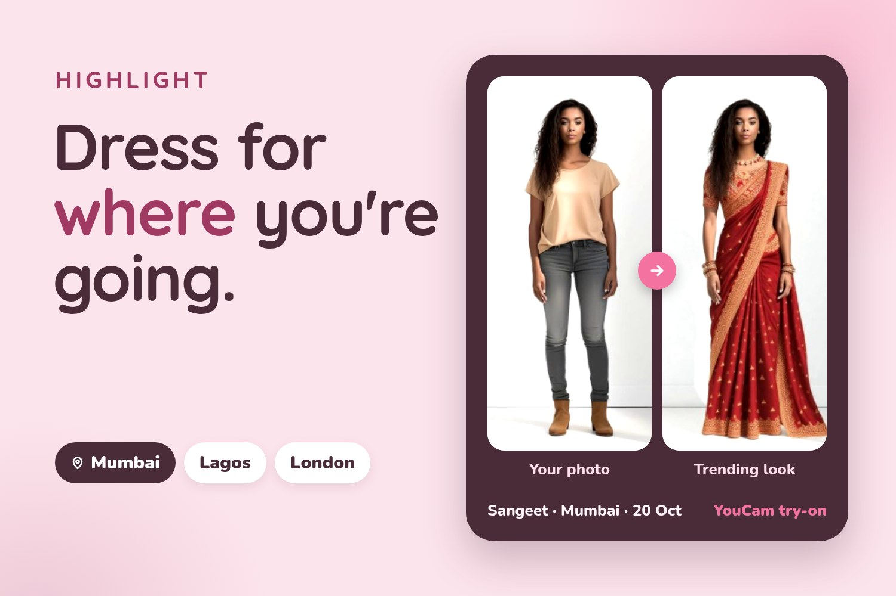
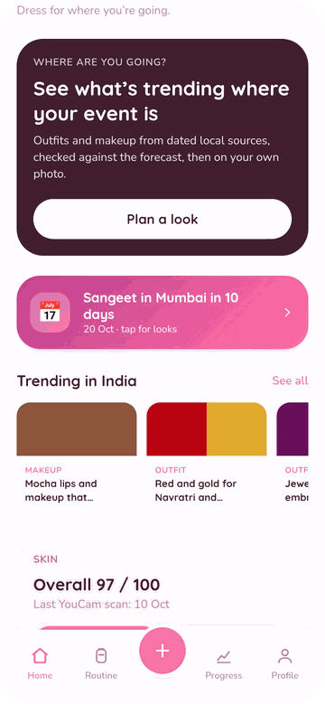
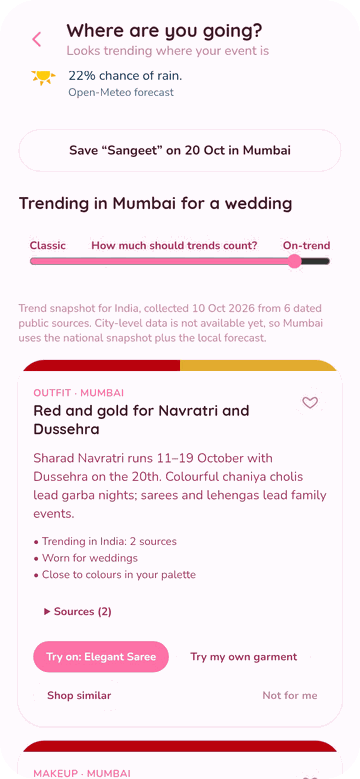
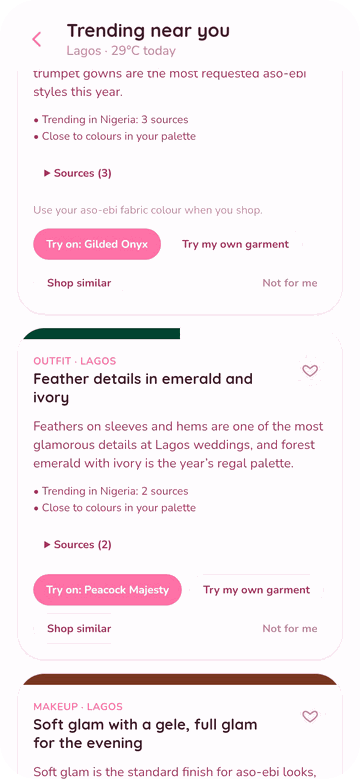
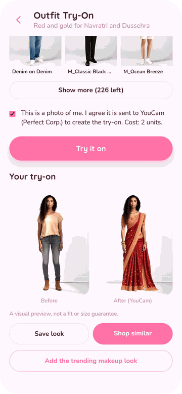
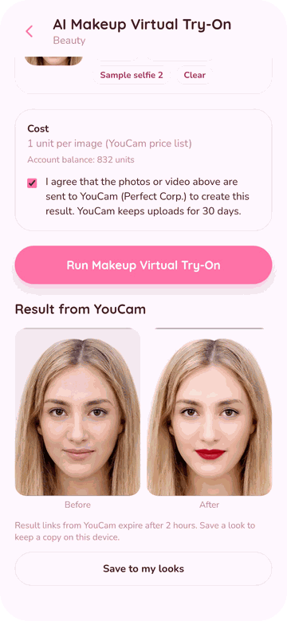
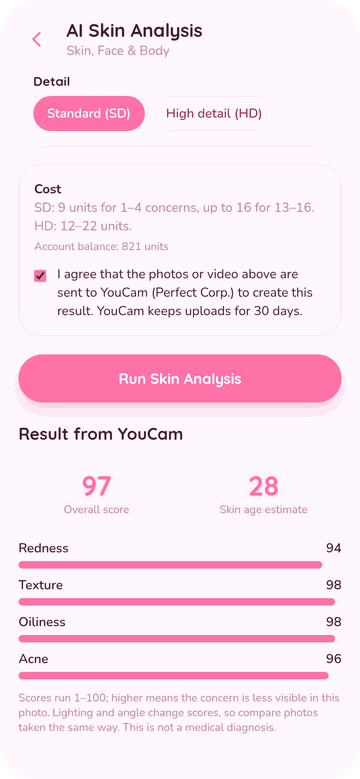
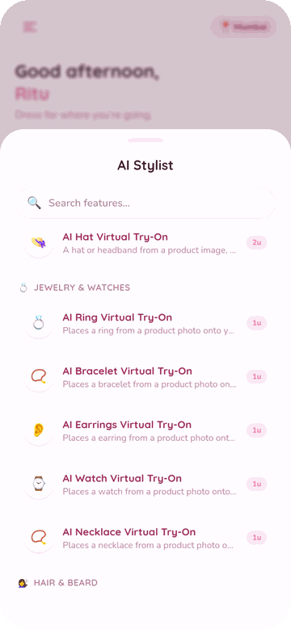
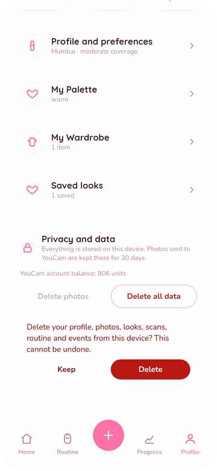
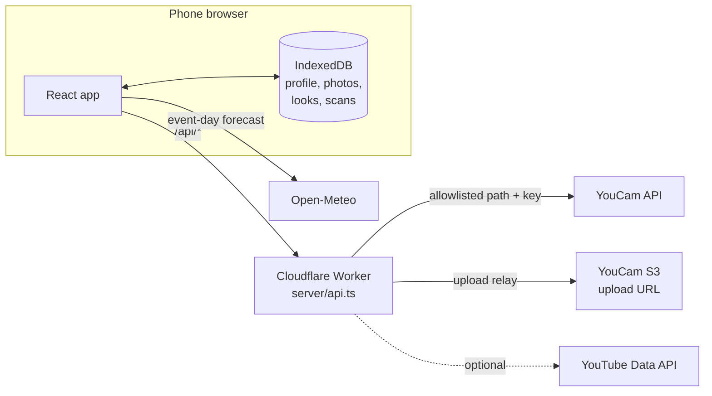

<p align="center">
  
</p>

<h1 align="center">HIGHLIGHT</h1>

<p align="center">
  <b>Dress for where you're going.</b><br>
  The outfits and makeup trending in your event's city, with dated sources,<br>
  checked against the forecast and your colours, then tried on your own photo with the YouCam API.
</p>

<p align="center">
  
  
  
  
  
  
  
</p>

<p align="center">Built for the <b>YouCam API Skin AI & eCommerce VTO Hackathon</b> (Devpost, 2026).</p>

---

## Why HIGHLIGHT

Most beauty and fashion apps give the same advice in Mumbai, Lagos and London. But what people wear to a wedding, a sangeet or an aso-ebi party changes from city to city and from month to month. Styles differ by city and spread between cities with a time lag ([GeoStyle, ICCV 2019](https://arxiv.org/abs/1908.11412); [From Paris to Berlin, CVPR 2020](https://arxiv.org/abs/2004.01316)).

People also don't plan a look in the abstract. They plan it a week before a specific event, in a specific place. So HIGHLIGHT starts with three questions: **what's the event, which city is it in, and when?**

| Principle | What it means in the app |
|---|---|
| **The location is where the event is** | A Mumbai user going to a Lagos wedding gets Lagos trends and the Lagos forecast. |
| **A trend is one input, not the boss** | Your own filters run first. A *Classic ↔ On-trend* dial sets how much trends count. |
| **Every trend shows its evidence** | Each trend lists its sources and dates. Where there's no city-level data, the app says so. |
| **Location never implies identity** | Religion, ethnicity or modesty is never inferred from a place. Coverage is your choice. |
| **No fake numbers** | Every score, streak and chart comes from a real YouCam scan or a real check-in. |

## Screens

<table>
  <tr>
    <td align="center" width="25%"><br><sub><b>Plan a look</b> for an event</sub></td>
    <td align="center" width="25%"><br><sub><b>Ranked looks</b> with forecast and dial</sub></td>
    <td align="center" width="25%"><br><sub><b>Trending near you</b>, with sources</sub></td>
    <td align="center" width="25%"><br><sub><b>Outfit try-on</b> (YouCam AI Clothes)</sub></td>
  </tr>
  <tr>
    <td align="center"><br><sub><b>Trend makeup</b> (YouCam Makeup VTO)</sub></td>
    <td align="center"><br><sub><b>Skin scan</b> (YouCam AI Skin Analysis)</sub></td>
    <td align="center"><br><sub><b>54 AI tools</b>, each with its price</sub></td>
    <td align="center"><br><sub><b>Privacy</b>: one tap deletes everything</sub></td>
  </tr>
</table>

## Features

| Feature | What it does | YouCam API |
|---|---|---|
| **Dress for an Occasion** | Pick the occasion, event city, date and your role. Get ranked looks, each explaining why it ranked. | — |
| **Trending near you** | Browse 8 cities. Every trend cites dated sources. Hidden looks show why they're hidden. | — |
| **Outfit try-on** | One tap puts a trending outfit on your own photo, using YouCam's licensed outfit templates. | AI Clothes |
| **Trend makeup** | The matching makeup trend, applied with effects chosen for that trend. | AI Makeup VTO |
| **My Wardrobe** | Photograph a garment you own and try it on before the event. | AI Clothes |
| **My Palette** | Pick your undertone, or measure it from a selfie. The palette ranks every look. | AI Facial Color Tones |
| **Skin scan & Progress** | YouCam skin scores, and a chart drawn from real scans only. | AI Skin Analysis |
| **My Routine** | Your own products, with a warning when actives clash (for example, a retinoid with an acid). | — |
| **Skin Prep** | A gentle plan counted back from the event date. | — |
| **AI Stylist** | All 54 YouCam AI tools. Each one shows its live unit price and your balance before it runs. | All of them |
| **Saved looks** | YouCam result links expire after 2 hours, so saved looks are copied to your phone. | — |

## How looks are ranked

Hard filters run first and remove a look completely: **minimum coverage**, **words you never want suggested** (like "sequin") and **womenswear or menswear**. Excluded looks stay visible in a "hidden" list with the reason.

Then every remaining look is scored ([`src/trends/engine.ts`](src/trends/engine.ts)):

| Factor | Weight |
|---|---|
| Local trend strength for this occasion | 0 – 0.5, set by the Classic ↔ On-trend dial |
| Occasion fit | 0.25 |
| Palette match (CIE76 ΔE in Lab space) | 0.20 |
| Event-day forecast ([Open-Meteo](https://open-meteo.com)) | 0.15 |
| Your likes | 0.10 |

Missing factors are dropped and the rest are renormalised.

Trend strength rewards fresh, well-sourced trends: `min(1, 0.45 × recency + 0.2 × min(sources, 3))`, where recency falls from 1 to a floor of 0.2 as a trend ages over 240 days.

## YouCam APIs used

| In HIGHLIGHT | YouCam API | Endpoint |
|---|---|---|
| Trend outfit try-on | AI Clothes (templates) | `v2.0/task/cloth` |
| Own-garment try-on | AI Clothes | `v2.0/task/cloth-v4` |
| Trend makeup | AI Makeup VTO | `v2.0/task/makeup-vto` |
| My Palette | AI Facial Color Tones | `v2.0/task/skin-tone-analysis` |
| Skin scan & Progress | AI Skin Analysis | `v2.0/task/skin-analysis` |
| AI Stylist | 11 skin, face & body · 6 beauty · 6 fashion · 5 jewellery & watch · 11 hair · 9 image · 6 video | [`src/stylist/features.ts`](src/stylist/features.ts) |
| Outfit and effect lists | Templates (free) | `v2.0/task/template/{feature}` |
| Price before every run | Feature cost (free) | `v2.0/credit/feature-cost` |
| Balance | Credit (free) | `v1.0/client/credit` |

Every task follows the same flow: the photo is uploaded through YouCam's File API, then the task is created, polled until it finishes, and the result is shown. That's why one generic runner ([`src/stylist/AIFeature.tsx`](src/stylist/AIFeature.tsx)) can drive all 54 tools.

## Architecture



The same handler, [`server/api.ts`](server/api.ts), runs inside the Vite dev server and in the Cloudflare Worker. It's the only code that touches provider keys.

- **Allowlisted proxy:** `/api/youcam/*` forwards only the endpoints the app uses. Anything else returns `403 PathNotAllowed` before the key is added.
- **Same-origin only:** cross-site requests are refused.
- **Spending caps:** video tasks are limited to 10 seconds, multi-image outputs to 4, and JSON bodies to 64 KB.
- **Rate limits:** each IP address can make 200 requests per 5 minutes and run 60 AI tasks per hour.
- **Upload relay:** `/api/upload` PUTs only to YouCam's S3 upload hosts, and only JPEG, PNG, MP4 or MOV up to 60 MB.

## Privacy

- **On the device:** profile, photos, looks and scans live in IndexedDB in the browser. Photos are resized before they're stored.
- **Sent only with consent:** a photo leaves the phone only when you run a feature, after you tick a consent box. YouCam keeps uploads for 30 days.
- **City, not coordinates:** "Use my location" picks the nearest supported city on the device. Coordinates are never stored or sent.
- **One-tap delete:** Profile → Privacy and data → Delete all data.

## Getting started

You need **Node.js 22+**, **pnpm** (or npm) and a **YouCam API key** from [yce.perfectcorp.com/ai-api](https://yce.perfectcorp.com/ai-api).

```bash
git clone https://github.com/Ritesh-Root/YOUcam.git
cd YOUcam
cp .env.example .env.local     # then add your YOUCAM_API_KEY
pnpm install                   # or: npm install
pnpm dev                       # open http://127.0.0.1:8443
```

Open it on a phone, or use your browser's mobile view. Most AI tools offer YouCam sample photos, so you can try them without a selfie.

| Variable | Required | What it's for |
|---|---|---|
| `YOUCAM_API_KEY` | Yes | All YouCam calls. It stays on the server and is never prefixed with `VITE_`. |
| `YOUTUBE_API_KEY` | No | Adds the month's most-viewed matching YouTube videos to trend pages. |
| `HOST` | No | Defaults to `127.0.0.1`. Set `HOST=0.0.0.0` to open the app from a phone on your network. |
| `PORT` | No | Defaults to `8443`. |

| Script | What it does |
|---|---|
| `pnpm dev` | Dev server with the `/api` handler |
| `pnpm build` | Production build into `dist/` |
| `pnpm preview` | Serves the build, with the `/api` handler |
| `pnpm typecheck` | TypeScript check |

## Deploy to Cloudflare Workers

```bash
pnpm build
npx wrangler secret put YOUCAM_API_KEY
npx wrangler secret put YOUTUBE_API_KEY   # optional
npx wrangler deploy
```

[`worker/index.ts`](worker/index.ts) serves `dist/` and runs the same `/api` handler as the dev server. See [`wrangler.jsonc`](wrangler.jsonc).

## Project structure

```
server/api.ts             /api handler: YouCam proxy, upload relay, live trends, health
worker/index.ts           Cloudflare Worker entry
src/youcam.ts             browser client: upload, run task, poll, templates, prices, balance
src/stylist/features.ts   the 54 AI tools: endpoint, inputs, settings, request body
src/stylist/AIFeature.tsx generic runner for any tool
src/stylist/TryOn.tsx     outfit try-on (templates and your own garment)
src/trends/data.ts        trend snapshot: 8 cities, 30 trends, dated sources
src/trends/engine.ts      filters, scoring, ΔE colour match, weather fit
src/store.tsx             app state, persisted to IndexedDB
src/screens/              Home, Routine, Progress, Profile
```

## Trend data

[`src/trends/data.ts`](src/trends/data.ts) is a hand-collected snapshot (10 Oct 2026) of 30 trends across 8 cities: Mumbai, Delhi, Bengaluru, Lagos, Dubai, London, New York and Seoul. Each trend has dated public sources and a YouCam template ID or makeup effects tested against the live API.

City-level data isn't available yet, so a city uses its country's snapshot plus its own forecast, and the app says so on screen. To refresh it, update the file and `SNAPSHOT_DATE`.

## Known limitations

- Trends are a dated snapshot at country level, not a live city-level feed.
- 5 of the 54 tools need a kind of photo YouCam's samples don't cover: earrings need visible earlobes, the necklace needs a centred neck, hair type and frizz need left and right head turns, and hair density needs the crown at 45°. The app shows YouCam's explanation when a photo doesn't fit.
- Rate limits live in Worker memory, so they reset when an isolate restarts.
- Try-on is a visual preview, not a fit or size guarantee.

## Roadmap

- [ ] A scheduled collector (YouTube, Reddit, Pinterest Trends) writing **city-level** trends to Cloudflare KV
- [ ] A side-by-side "Compare cities" view
- [ ] A global daily unit cap, and rate limits in a Durable Object
- [ ] Testing with real users in at least two cities

## License

[MIT](LICENSE) © 2026 Ritesh
